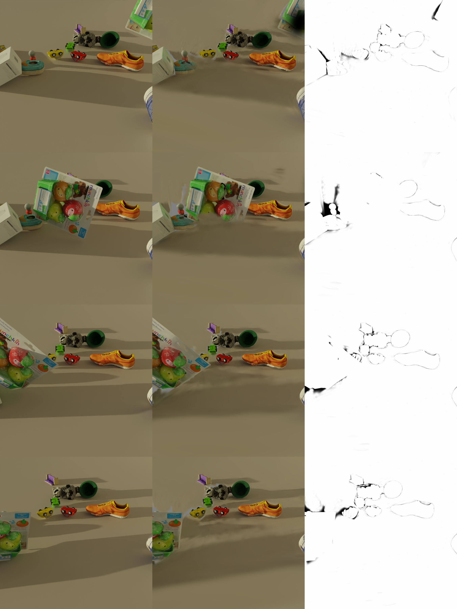

# Gaussian JEPA 3D scene data

We fitted object-local 3D Gaussian scenes to 24-frame, 768 × 768 Kubric MOVi-E videos. The public [data archive](https://huggingface.co/datasets/bigwolfe/gaussian-jepa-3d-data) contains **301 complete scene, projected-token, and 3D-target triples** and **92 additional token-target pairs without saved scenes**. Seven clips have `.failed` markers. The 1,087 archived data files total 69,225,016,637 bytes. `scene/` holds 3D fits, `gauss/` holds projected tokens, and `dv/` holds aligned world-space targets.

This repository holds the SHA-256 manifest, a checked sample image, and a small loader. The full files and a complete sample are in the data archive. Run `python load_clip.py PATH_TO_DATA clip00000` after downloading. Run `python verify_manifest.py PATH_TO_DATA` to hash the archive.

Data volume and coverage limited further tracking tests. A 12-clip MOVi probe had one heavy occlusion followed by a reveal and no full occlusions. The near-straight camera path also leaves moving-object depth ambiguous. Our 804 extra 2D Gaussian trajectory clips are separate; they are not 3D scene fits.

Generated data: CC BY 4.0. Original utility code: Apache 2.0. Google Scanned Objects and Poly Haven source credits are in [ATTRIBUTION.md](ATTRIBUTION.md).
